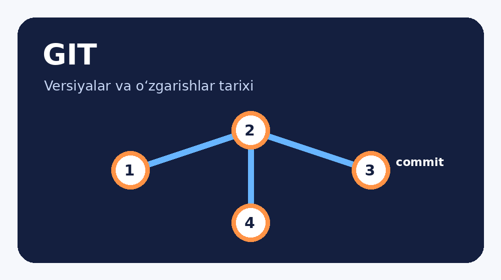

# Git & GitHub Master Guide

8-sinf uchun individual amaliy loyiha.

## Muallif
Shermuhammad Mahkamov

## Loyiha maqsadi
Bu loyiha Git, GitHub va Terminal komandalarini o‘rganish, ularni amalda bajarish va o‘zgarishlarni versiyalar tarixi orqali boshqarish uchun yaratildi.

## Loyiha bo‘limlari
- **Git Guide** — Git asoslari va asosiy komandalar.
- **GitHub Guide** — GitHub platformasi va remote komandalar.
- **Terminal Guide** — terminal va fayl/papka komandalar.

## Branchlar
- `main` — loyiha haqida umumiy ma’lumot, `.gitignore`, rasmlar va foydali havolalar.
- `git-guide` — `git-guide/git-commands.md` qo‘llanmasi.
- `github-guide` — `github-guide/github-commands.md` qo‘llanmasi.
- `terminal-guide` — `terminal-guide/terminal-commands.md` qo‘llanmasi.

## Ishlash tartibi
Har bir mavzu alohida branchda tayyorlanadi. Har bir branchda kamida ikkita mazmunli commit yaratiladi va GitHub’ga alohida push qilinadi. Ushbu topshiriq davomida branchlar merge qilinmaydi.

## Rasmlar
- `images/git.png` — Git va versiyalar tarixi haqidagi tasvir.
- `images/github.png` — GitHub va masofaviy hamkorlik haqidagi tasvir.

## Maqsad
O‘rgangan komandalarimni amalda qo‘llash va ularni Markdown hujjatlarida tushunarli tarzda bayon qilish.

## 🔗 Rasmlar

### Git va versiyalar tarixi

### GitHub va masofaviy hamkorlik

